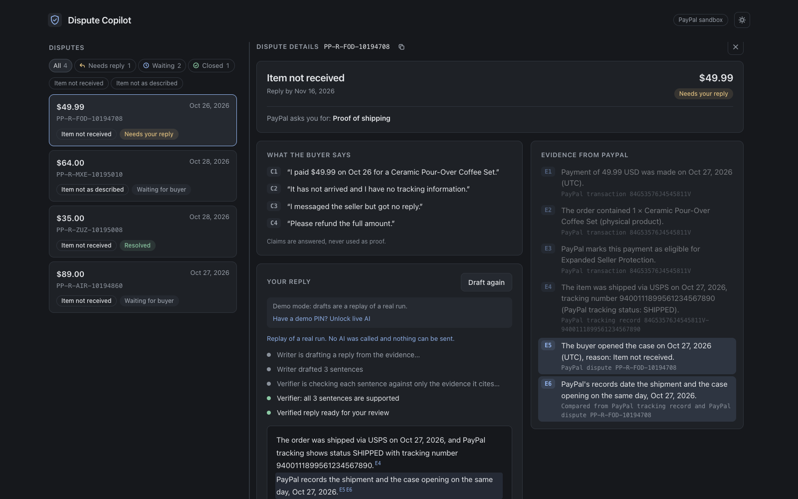
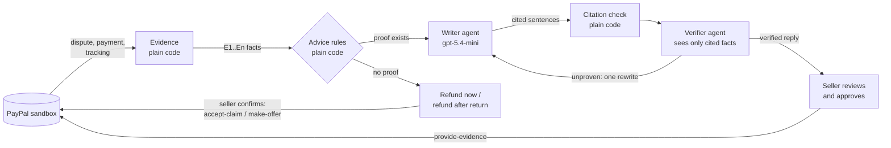

# Dispute Copilot

**AI that answers PayPal disputes for small sellers, where every sentence links to its proof.**

[](https://github.com/KumarPadigeri/paypal-dispute-copilot/actions/workflows/ci.yml)
· **Live demo: https://dispute-copilot-zi8a.onrender.com/** · Built for the
[PayPal AI Hackathon 2026](https://paypalaihackathon.devpost.com/) · PayPal sandbox only



## The problem

When a buyer opens a PayPal dispute, the seller has a deadline to answer with proof. Small
sellers often lose cases they should win: the proof (payment, order, tracking) sits on
different screens, the deadline passes, or the reply is vague or angry. Generic AI writing
tools make this riskier, not safer: one invented sentence ("the item was delivered") can
lose the case.

## What Dispute Copilot does

1. **Gathers the evidence from PayPal**: the payment, the items, Seller Protection status and
   shipment tracking, as numbered facts (E1, E2, …).
2. **Writes a calm reply** (Writer agent) that answers the buyer's own claims (C1, C2, …),
   where every sentence cites the facts it rests on.
3. **Checks every sentence** (Verifier agent) against *only* the evidence it cites. A
   sentence that says more than its proof ("shipped *before* the case was opened") goes back
   to the Writer once; if it is still unproven, it is removed and shown to the seller.
4. **Knows when not to fight.** No tracking on an "item not received" case, or no proof of
   what was shipped on a "not as described" case: it says so and offers a fair way out
   (refund now, or refund after return) instead of drafting an argument it cannot back up.
5. **The seller approves.** Nothing reaches PayPal until the seller clicks, and only the
   last *verified* reply can be sent.

## For judges: a 2-minute tour

1. Open the **[live demo](https://dispute-copilot-zi8a.onrender.com/)**. It runs on Render's
   free plan: if it has been idle, the first load can take about a minute.
2. Click the **$49.99** case (`PP-R-FOD-10194708`), then **Draft reply**. Without a PIN you see
   a **replay of a real run**: the agent timeline, the Verifier's verdicts, the final reply.
   Point at a sentence to light up the evidence it cites.
3. Look at the other cases: one was **refunded** and one got a **return offer**, both sent
   from this app through PayPal's dispute API.
4. **Live AI and sending:** click *Have a demo PIN? Unlock live AI* and use the PIN from the
   Devpost submission's private testing notes. Drafting then calls the real model, and
   *Approve & send* posts the evidence to the PayPal sandbox.

Everything is sandbox money and made-up customers. No real personal data is used.

## How it works



The rules that keep it honest:

- **Facts come from PayPal and code; the AI only writes and checks.** Date comparisons
  ("the shipment and the case opening are both dated Oct 27, 2026") are computed by code and
  given to the Writer as evidence, so it never has to infer them.
- **Buyer statements are claims, never proof.** They are answered, not cited.
- **Money-moving actions use fixed text written in code**, never AI text, and need the
  seller's confirmation.
- **Only verified text can be sent**: the server keeps the last verified reply and sends
  exactly that, once.
- **Public demo costs nothing**: without the PIN, drafting replays a recorded real run and can
  never be sent; with the PIN, live drafts are capped per day.

## How PayPal is used

| PayPal API (sandbox) | Used for |
|---|---|
| `POST /v1/oauth2/token` | App authentication |
| `GET /v1/customer/disputes`, `GET /v1/customer/disputes/{id}` | Dispute list, case details, buyer messages, what PayPal asks for |
| `GET /v1/shipping/trackers` | Shipment tracking as evidence |
| `POST /v1/customer/disputes/{id}/provide-evidence` | Sending the verified reply with proof of fulfillment |
| `POST /v1/customer/disputes/{id}/accept-claim` | "Refund the buyer now" |
| `POST /v1/customer/disputes/{id}/make-offer` | "Offer refund after return" |
| `POST /v1/shipping/trackers-batch` | Demo setup only (`scripts/add_tracking.py`): attach a tracking number like a seller would |

## How AI is used

- **Microsoft Agent Framework** runs two agents on **gpt-5.4-mini** in **Microsoft Foundry**.
- The **Writer** returns structured output (each sentence with the evidence ids it cites and
  the buyer claims it answers), so plain code can check every citation.
- The **Verifier** gets each sentence with only its cited evidence and returns a verdict and a
  reason per sentence. The loop (write, check, verify, one rewrite, remove) is plain code.

## Tech stack

Python 3.11, FastAPI with server-sent events · Microsoft Agent Framework, Microsoft Foundry
(gpt-5.4-mini) · React, TypeScript, Vite · pytest, Playwright, ruff, ESLint · GitHub Actions ·
Docker on Render.

## Run it yourself

You need a PayPal developer account (free sandbox app), an Azure AI Foundry model deployment,
Python 3.11 and Node 20.

```bash
cp .env.example .env            # fill in the PayPal sandbox app and Foundry endpoint
python3.11 -m venv .venv && .venv/bin/pip install -r requirements-dev.txt
npm --prefix web ci

az login                         # local AI auth (the hosted app uses FOUNDRY_API_KEY)
.venv/bin/uvicorn copilot.api:app --reload    # API on http://localhost:8000
npm --prefix web run dev                       # UI on http://localhost:5173
```

Leave `DEMO_PIN` empty locally and everything is live. Test disputes are created in the PayPal
sandbox website as the buyer (pay by card, then *Report a problem*); add tracking with
`.venv/bin/python -m scripts.add_tracking <seller transaction id> <tracking number>`.

**Tests:** `.venv/bin/pytest` (unit, no network) and, after `npm --prefix web run build`,
`.venv/bin/pytest -m e2e` (browser tests against a fake PayPal made from saved sandbox data).
CI runs both on every push.

## Project layout

```
copilot/        evidence.py (facts from PayPal) · advice.py (when not to fight)
                writer.py · verifier.py · pipeline.py (the loop) · submit.py (what is sent)
                api.py (FastAPI + SSE) · demo.py (PIN, daily cap, replay) · paypal_client.py
web/            React UI (list, case panel, live draft, approve and send)
tests/          unit tests · e2e/ browser tests with a fake PayPal
scripts/        add_tracking.py · record_replay.py · screenshots.py
```

## Honest limitations

- **Sandbox only.** Test disputes are opened through the sandbox website, because PayPal's
  buyer-side dispute API needs partner permissions.
- **One server instance**: the verified-reply store and daily cap live in memory, which suits a
  single free Render instance, not a fleet.
- **English, US dollars**, and the two most common dispute reasons so far.

## License

[MIT](LICENSE)
